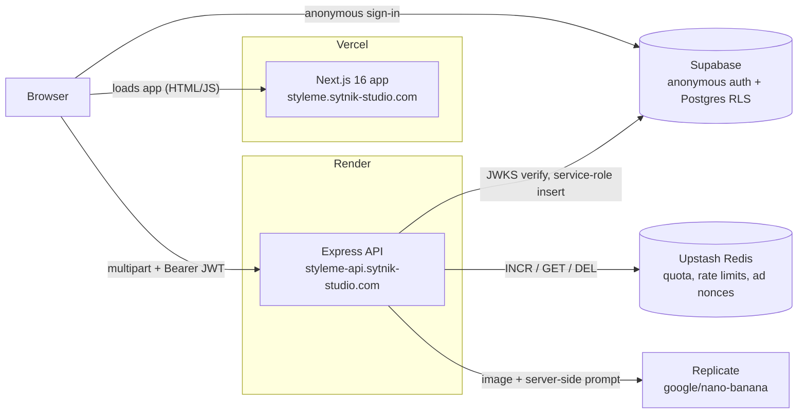

# StyleMe

AI hairstyle try-on: upload a selfie, pick a style, get a photorealistic result. The server stays authoritative over every credit spent.

[](https://github.com/IvanSytnik/styleme/actions/workflows/ci.yml)

**Live:** <https://styleme.sytnik-studio.com>. **Status:** a closed beta is in preparation. The app is deployed, but several beta blockers are still open (see [Known limitations](#known-limitations-honest)). There are no screenshots yet.

A user uploads a photo and chooses a hairstyle in one of three ways: from a 40-preset catalog, as a free-text description, or with a reference photo. The image is generated by `google/nano-banana` on Replicate. Every generation costs real money, so quota, rate limiting and abuse resistance all live on the server. The client is trusted with none of them.

---

## The problem with v2

This repository is a rewrite of an earlier MVP ([ADR-001](docs/adr/001-hybrid-rewrite.md)):

- **Monetization lived in `localStorage`.** Ad credits could be minted by opening DevTools.
- **There was no server-side quota.** The backend had no auth, no rate limiting and no quotas.
- **The frontend was a single 633-line `App.tsx`** on an unmaintained CRA toolchain.
- **Images were uploaded as base64 inside JSON** behind `express.json({ limit: '50mb' })`. That meant a 33 % size overhead and a parser DoS surface ([ADR-005](docs/adr/005-phase-0-security.md)).

v3 keeps the working backend logic, rebuilds the frontend in Next.js, and moves everything billing-adjacent behind Supabase-authenticated, Redis-backed server checks.

---

## How it works



The browser loads the app from Vercel and then calls the API directly; Next.js does not proxy API traffic. The web app never holds a service-role key and never talks to Replicate.

**One generation, step by step:**

1. The browser downscales the photo on a Canvas, EXIF-aware, to a 1024 px maximum edge.
2. It POSTs `multipart/form-data` with the Supabase-issued JWT.
3. The API verifies the JWT, applies the per-IP and per-user rate limits, and checks quota.
4. `sharp` normalizes the image. The preset prompt is resolved server-side.
5. Replicate is called with retry on throttling.
6. A credit is consumed, a row is written to `generations` (service role), and the result is returned together with a fresh balance snapshot.

---

## Server-side guarantees

All numeric limits come from [`packages/shared/src/constants/limits.ts`](packages/shared/src/constants/limits.ts), which is shared by the API and the web app.

| Guarantee | How | Where |
| --- | --- | --- |
| **Authentication** | Supabase JWT verified with `jose`: ES256/RS256 via JWKS, HS256 fallback for legacy projects. The dev-user fallback is refused in production | [`apps/api/src/middleware/auth.ts`](apps/api/src/middleware/auth.ts) |
| **Daily quota** | `QUOTA.FREE_DAILY` = **3** free generations per UTC day, keyed by user ID. Rewarded credits are capped at `MAX_REWARDED_BALANCE` = **50**, and the balance expires `REWARD_TTL_DAYS` = **7** days after the last grant | [`apps/api/src/lib/quota.ts`](apps/api/src/lib/quota.ts) |
| **Rate limits** | `API_PER_IP_PER_MINUTE` = **60** across `/api/*`; `TRANSFORM_PER_USER_PER_HOUR` = **10**. Fixed windows in Redis | [`apps/api/src/lib/rate-limit.ts`](apps/api/src/lib/rate-limit.ts), [`apps/api/src/middleware/rate-limit.ts`](apps/api/src/middleware/rate-limit.ts) |
| **Rewarded-ad nonce contour** | A server-issued UUID nonce bound to the user (`SESSION_TTL_SECONDS` = 300). The claim is refused before `MIN_WATCH_SECONDS` = **15**. Views are capped at `MAX_VIEWS_PER_DAY` = **10** (`CREDITS_PER_VIEW` = 1), and the nonce is burned atomically, with the Redis `DEL` return value as arbiter ([ADR-009](docs/adr/009-rewarded-ads.md)) | [`apps/api/src/lib/ad-session.ts`](apps/api/src/lib/ad-session.ts), [`apps/api/src/routes/billing.ts`](apps/api/src/routes/billing.ts) |
| **Upload validation** | Multipart (multer, in-memory storage), `MAX_FILE_SIZE_BYTES` = **2 MB**, MIME allowlist `image/jpeg`, `image/png`, `image/webp`. `sharp` re-encodes to JPEG, max edge 1024. JSON bodies are capped at **256 KB**. Client side, originals over 25 MB are rejected before the resize | [`apps/api/src/routes/transform.ts`](apps/api/src/routes/transform.ts), [`apps/web/src/lib/validate-source-file.ts`](apps/web/src/lib/validate-source-file.ts) |
| **Sanitized errors** | Every response uses the `{ success, data?, error?: { code, message } }` envelope with a stable `code`. Upload errors are mapped by `instanceof`. Raw exception messages never reach clients in production | [`apps/api/src/middleware/error-handler.ts`](apps/api/src/middleware/error-handler.ts) |
| **Log redaction** | pino redacts the `authorization` and `cookie` headers, `set-cookie`, `*.password`, `*.token`, `*.apiKey`, and the Replicate, Supabase service-role and Upstash token fields | [`apps/api/src/logger.ts`](apps/api/src/logger.ts) |
| **Shared Zod schemas** | The same schema objects validate API requests and client forms (for example, `transformCustomSchema` for the 10–200-character prompt) | [`packages/shared/src/schemas/index.ts`](packages/shared/src/schemas/index.ts) |
| **Server-only prompts** | Preset prompts are exported only via the `@styleme/shared/hairstyles/prompts` subpath and imported only by the API. The root export omits them | [`packages/shared/package.json`](packages/shared/package.json), [`apps/api/src/routes/transform.ts`](apps/api/src/routes/transform.ts) |
| **Fail-fast API env** | Zod-validated at import. Production refuses to start without `FRONTEND_URL`, Supabase and Upstash, or with `REPLICATE_MOCK=1` | [`apps/api/src/env.ts`](apps/api/src/env.ts) |
| **CORS** | Single origin, pinned to `FRONTEND_URL`, with no wildcards | [`apps/api/src/server.ts`](apps/api/src/server.ts) |
| **Row-level security** | `generations` has RLS enabled; users can read and soft-delete only their own rows | [`supabase/migrations/`](supabase/migrations/) |

---

## Measured

Measured on 2026-10-23 against commit `4dd4587` (no code has changed since).

| What | Result |
| --- | --- |
| Unit tests, `packages/shared` (Vitest) | **9 passed** |
| Unit + contract tests, `apps/api` (Vitest) | **28 passed, 8 skipped**. The skipped half of the dual-backend contract test runs against real Upstash only when `TEST_UPSTASH_*` credentials are set |
| E2E (Playwright, Chromium) | **6 tests in 3 spec files**: happy path, quota exhaustion, locale routing. Runs in CI as a non-blocking job |
| Lighthouse 12.8.2, mobile | Performance **83** · Accessibility **93** · Best practices **96** · SEO **100** |
| Lighthouse 12.8.2, desktop | Performance **100** · Accessibility **94** · Best practices **96** · SEO **100** |
| First Load JS, `/[locale]` (`next build`) | **294 KB** gzip (1,091 KB raw) |
| ADRs | 13 (001–012, 014; 013 is reserved) |
| i18n | 4 locales (en, de, uk, ru), **188 keys each**, no key drift |
| Hairstyle presets | **40** (20 women's, 20 men's) |
| `npm audit --omit=dev` | **11 vulnerabilities: 2 critical, 4 high, 5 moderate.** These include `sharp` 0.33.5, `multer` 2.2.0 and `next` 16.2.9; upgrades are planned (wave W6) |

---

## Known limitations (honest)

- **Anti-abuse hardening** (CAPTCHA on anonymous sign-in, per-IP caps, atomic reward claim) is in progress before public launch (wave W3b).
- **History images expire.** History stores Replicate's delivery URL, and Replicate deletes outputs about an hour after creation. In the 2026-10-11 audit, every stored Replicate URL returned 404. Persisting results to Storage is wave W1.
- **There are no legal pages.** The app has no imprint, privacy policy or terms, and no notice that photos are processed by Replicate in the US. This is a beta blocker (wave W2).
- **Render free-tier cold start.** When idle, the API spins down. A cold `/health` took 32 s in the 2026-10-11 audit.
- **The API is far from users and the database.** It runs in Render's US-West region, while Supabase and the target users are in the EU. See [ADR-014](docs/adr/014-hosting-and-domains.md).
- **Other gaps:** no error monitoring, no content moderation on uploaded photos, no security headers on the web app, unreadable dark mode on the history screens, and the E2E CI job is non-blocking.
- **Open audit findings:** 34 as of 2026-10-23 (2 P0, 17 P1, 15 P2). The fixes are grouped into the waves under [Roadmap](#roadmap).

---

## Stack

| Layer | Technology |
| --- | --- |
| Monorepo | npm workspaces: `apps/api`, `apps/web`, `packages/shared` ([ADR-002](docs/adr/002-monorepo.md)) |
| Web | Next.js 16.2.9 (App Router, Turbopack), React 19.2.4, TanStack Query 5, Zustand 5, React Hook Form, CSS Modules + design tokens, `next-themes`, `next-intl` 4 |
| API | Express 4, TypeScript 5 (strict), multer 2, `sharp` 0.33, `jose`, pino |
| Data | Supabase (anonymous auth, Postgres + RLS), Upstash Redis (REST) |
| AI | Replicate, `google/nano-banana` |
| Validation | Zod 3, schemas shared between client and server |
| Tests | Vitest, Playwright |
| CI | GitHub Actions |
| Hosting | Vercel (web), Render (API), Cloudflare DNS ([ADR-014](docs/adr/014-hosting-and-domains.md)) |

---

## Repository structure

```text
apps/
  api/                 Express + TypeScript (CommonJS)
    src/
      env.ts           Zod-validated env, fail-fast at import
      server.ts        middleware chain and routers
      middleware/      auth, rate-limit, validate, error-handler, request-id
      routes/          health, hairstyles, transform, billing, generations
      lib/             redis, quota, rate-limit, ad-session, cursor, replicate-*
      db/              generations table access (service role)
    tests/             Vitest unit + dual-backend contract tests
  web/                 Next.js 16 App Router
    src/
      app/[locale]/    locale-segmented layout + page
      features/        upload, catalog, processing, result, history, rewards, theme
      lib/             api-client, auth-provider, app-store, image-resize, env
      i18n/            next-intl routing + request config
      messages/        en, de, uk, ru
      proxy.ts         next-intl locale negotiation
    e2e/               Playwright specs
packages/shared/       types, Zod schemas, limits, catalog, server-only prompts
supabase/migrations/   idempotent SQL migrations
docs/adr/              architecture decision records
.github/workflows/     CI
```

---

## Run locally

**Use your own Supabase and Upstash projects for local development, never the production ones.** Local runs, including E2E, create anonymous users and write quota counters wherever the env points. You can also leave Supabase and Upstash empty: in development the API falls back to a deterministic dev user and an in-memory Redis.

Prerequisites: Node.js 20 (`.nvmrc`), npm 9+, a Replicate API token (not needed with `REPLICATE_MOCK=1`).

```bash
git clone https://github.com/IvanSytnik/styleme.git
cd styleme
npm install

cp apps/api/.env.example apps/api/.env
cp apps/web/.env.example apps/web/.env.local

npm run build:shared   # required first: the API and web resolve @styleme/shared from dist/
npm run dev:api        # http://localhost:3001
npm run dev:web        # http://localhost:3000
```

If you use your own Supabase project, enable anonymous sign-ins and apply the migrations in [`supabase/migrations/`](supabase/migrations/) in filename order. They are idempotent.

| Command | Purpose |
| --- | --- |
| `npm run typecheck` | `tsc --noEmit` across workspaces |
| `npm run test` | Vitest (shared + api) |
| `npm run e2e --workspace=@styleme/web` | Playwright. Boots both servers with `REPLICATE_MOCK=1`, uses real Supabase anonymous auth from your env (see `apps/web/.env.e2e.example`) |
| `npm run lint --workspace=@styleme/web` | ESLint 9 |
| `npm run build:api` / `npm run build:web` | Production builds |

Any change under `packages/shared/src` requires `npm run build:shared` and an API restart.

### Environment variables

**API** (`apps/api/.env`). "Prod" means the process exits at boot if the variable is missing when `NODE_ENV=production`.

| Variable | Required | Notes |
| --- | --- | --- |
| `REPLICATE_API_TOKEN` | Yes | |
| `FRONTEND_URL` | Prod | The single allowed CORS origin. Defaults to `http://localhost:3000` |
| `SUPABASE_URL`, `SUPABASE_ANON_KEY`, `SUPABASE_SERVICE_ROLE_KEY` | Prod | The service-role key stays in the API only |
| `SUPABASE_JWT_SECRET` | No | Legacy HS256 projects only |
| `UPSTASH_REDIS_REST_URL`, `UPSTASH_REDIS_REST_TOKEN` | Prod | |
| `REPLICATE_MOCK` | No | `1` returns a canned image. Refused in production |
| `PORT`, `NODE_ENV`, `LOG_LEVEL` | No | Defaults: `3001`, `development`, `info` |

**Web** (`apps/web/.env.local`). All are optional at build time.

| Variable | Default | Notes |
| --- | --- | --- |
| `NEXT_PUBLIC_API_URL` | `http://localhost:3001` | |
| `NEXT_PUBLIC_SUPABASE_URL`, `NEXT_PUBLIC_SUPABASE_ANON_KEY` | unset | Unset means dev-user fallback |
| `NEXT_PUBLIC_AD_PROVIDER` | `dev` | `dev` (15 s test modal), `gpt` (skeleton), `off`. Production uses `off` |

---

## Deploy

| Part | Platform | Domain |
| --- | --- | --- |
| Web | Vercel, project root `apps/web` ([`apps/web/vercel.json`](apps/web/vercel.json) builds `@styleme/shared` first) | `styleme.sytnik-studio.com` |
| API | Render web service (liveness at `/health`) | `styleme-api.sytnik-studio.com` |
| DNS | Cloudflare, **DNS-only** (unproxied) CNAMEs to Vercel and Render | `sytnik-studio.com` |

Production checklist: `FRONTEND_URL=https://styleme.sytnik-studio.com` on the API; `NEXT_PUBLIC_API_URL`, `NEXT_PUBLIC_SUPABASE_*` and `NEXT_PUBLIC_AD_PROVIDER=off` on Vercel. `NEXT_PUBLIC_*` values are inlined at build time, so changing them requires a redeploy. All credentials come from the provider dashboards, never from the repository. The rationale is in [ADR-014](docs/adr/014-hosting-and-domains.md).

### API endpoints

| Method | Path | Auth | Purpose |
| --- | --- | --- | --- |
| `GET` | `/health` | — | Liveness: status and API version |
| `GET` | `/api/hairstyles` | — | Preset catalog metadata (no prompts) |
| `POST` | `/api/transform` | Bearer | Transform by preset ID |
| `POST` | `/api/transform/custom` | Bearer | Transform by free-text description |
| `POST` | `/api/transform/reference` | Bearer | Transform from a reference photo |
| `GET` | `/api/billing/balance` | Bearer | Free and rewarded credits |
| `POST` | `/api/billing/ad-session` | Bearer | Issue a user-bound ad nonce |
| `POST` | `/api/billing/grant-reward` | Bearer | Redeem a nonce for a credit |
| `GET` | `/api/generations` | Bearer | History, keyset-paginated |
| `DELETE` | `/api/generations/:id` | Bearer | Soft delete |

---

## Roadmap

The waves come from the 2026-10-11 production-readiness audit, in suggested order. W1, W2 and W3b gate the closed beta.

| Wave | Topic |
| --- | --- |
| W1 | Persistent result images: private Supabase Storage, signed URLs, image fallbacks, safe download/share |
| W2 | Legal pages and consent: imprint, privacy policy, terms, footer, processor disclosure (en/de/uk/ru) |
| W3a | House ad provider (simulated rewarded ads for the beta) |
| W3b | Abuse caps: per-IP daily transform cap, global spend breaker, atomic ad claim, Supabase anonymous sign-in limits |
| W4 | Camera: desktop capture decision, HEIC handling |
| W5 | Dark-theme token cleanup on the history and rewards screens |
| W6 | Dependency upgrades (`sharp`, `multer`, `next`) and web security headers |
| W7 | Shell polish: icons, localized metadata, branded 404/error pages, zoom, copy fixes |
| W8 | Error monitoring |
| W9 | Separate dev/E2E environments from production (ADR-013, reserved) |
| W10 | Preset preview images instead of emoji |
| W11 | Retention and deletion: hard-delete job, "delete my data" |
| W12 | Hosting: paid Render plan or keep-warm to remove cold starts |

---

## Architecture decisions

| ADR | Title | Note |
| --- | --- | --- |
| [001](docs/adr/001-hybrid-rewrite.md) | Hybrid rewrite strategy | |
| [002](docs/adr/002-monorepo.md) | Monorepo with npm workspaces | Hosting parts superseded by ADR-014 |
| [003](docs/adr/003-nextjs-app-router.md) | Web framework: Next.js 16 App Router | |
| [004](docs/adr/004-auth-data-stack.md) | Auth + data stack: Supabase + Upstash Redis | Hosting parts superseded by ADR-014 |
| [005](docs/adr/005-phase-0-security.md) | Phase 0 security architecture | Hosting parts superseded by ADR-014 |
| [006](docs/adr/006-design-system.md) | Design system & theming | |
| [007](docs/adr/007-day4-stack.md) | Custom prompt, reference photo, toast notifications | |
| [008](docs/adr/008-history-and-soft-delete.md) | Generation history + soft delete | |
| [009](docs/adr/009-rewarded-ads.md) | Rewarded ads: nonce contour instead of SSV | |
| [010](docs/adr/010-i18n-catalog-data-model.md) | i18n strategy & catalog data model | |
| [011](docs/adr/011-testing-strategy.md) | Testing strategy: Vitest, DI factories, dual-backend contract tests, CI | |
| [012](docs/adr/012-e2e-replicate-mock.md) | E2E testing: Playwright, Replicate mock, restored i18n middleware | |
| 013 | Environment separation | Reserved |
| [014](docs/adr/014-hosting-and-domains.md) | Hosting and domains | Supersedes the hosting parts of 002, 004 and 005 |

---

## License and contact

Proprietary. See [`LICENSE`](LICENSE). The source is published for evaluation and review only; it is not licensed for use, modification or redistribution.

Author: Ivan Sytnik, [github.com/IvanSytnik](https://github.com/IvanSytnik). For licensing inquiries, contact the copyright holder.
